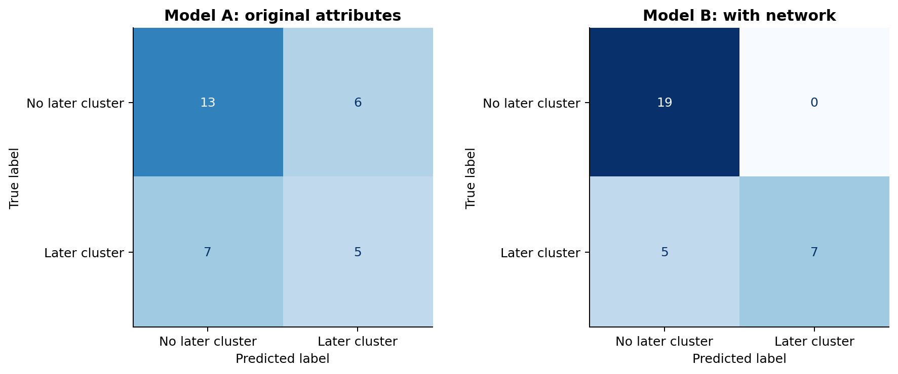
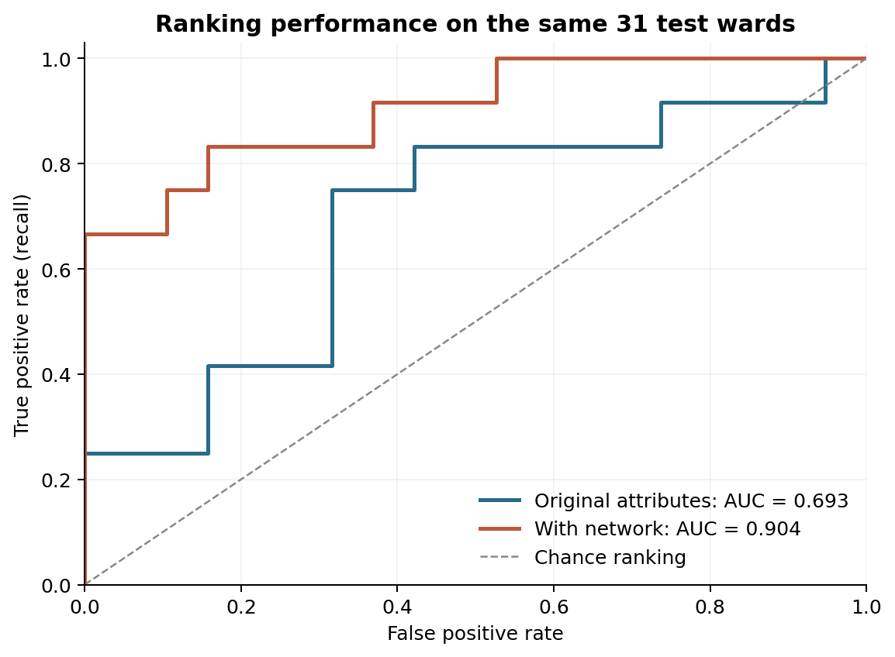

# Hospital Infection Control: Do Earlier Transfers Improve Prediction?

**Complex Systems and Applications — Final Project Portfolio (Option 1)**

## 1. Project title and description

This project asks whether network information taken from earlier patient movements between wards improves a prediction of new infection clusters over the following 14 days, compared with using the two ward-level attributes on their own.

- [Hospital_Infection_Control_Completed.ipynb](Hospital_Infection_Control_Completed.ipynb): the executed notebook, with all outputs visible
- [Hospital_Infection_Control_Completed.html](Hospital_Infection_Control_Completed.html): the same notebook, readable in a browser
- [Hospital_Infection_Control_Completed.pdf](Hospital_Infection_Control_Completed.pdf): the same notebook and outputs, rendered for printing

## 2. Problem statement

Hospital-acquired infection clusters are a serious clinical risk, and routine surveillance tends to look at individual wards: how full they are, and how many of their patients are on invasive devices. Wards are not isolated units, though. Patients move between them, so infection activity in one ward is a potential exposure for every ward that receives its patients.

The question here is whether those earlier movements carry information that the ward attributes alone do not.

The timeline has three parts. Directed transfers are recorded over the 14 days before the observation point. At the observation point (day 0), each ward's occupancy ratio, device-use share and current cluster status are known. The outcome, whether a ward reports a new cluster, covers the 14 days after that point.

Eighteen of the 120 wards already had an active cluster at day 0. They cannot develop a *new* one, so their later outcome is blank and they are left out of the prediction sample. That leaves 102 eligible wards, of which 39 develop a later cluster and 63 do not. The 18 affected wards stay in the network, because they are the sources of the transfers that create exposure elsewhere.

## 3. Data set and variables

Both files are synthetic and were supplied for the course. The ward table, [`data/hospital_wards.csv`](data/hospital_wards.csv), has one row per ward (120 in total):

- `ward_id`: identifier, used only for joining
- `occupancy_ratio`: occupied-bed fraction, between 0 and 1
- `device_use_share`: fraction of patients with an invasive device
- `active_cluster_at_start`: 1 if a cluster is already active at day 0
- `new_cluster_later`: the later binary outcome, blank for the 18 ineligible wards

The transfer table, [`data/hospital_transfers.csv`](data/hospital_transfers.csv), has one row per ordered pair of wards: `source_ward_id`, `destination_ward_id` and `transfer_count`. It contains 420 directed links carrying 2,101 transfers in total.

A blank `new_cluster_later` means the ward was ineligible, not that no cluster occurred. Filling those blanks with zero would mislabel all 18.

## 4. Method

The 120 wards and 420 transfers form a directed, weighted graph, with `transfer_count` as the edge weight. Two features were then calculated for every ward:

1. total incoming transfer volume, the sum of the counts on all incoming links
2. incoming volume from wards that were already affected at day 0, the sum over incoming links whose source had `active_cluster_at_start = 1`

Both use only information available at the observation point, and neither uses the later outcome.

Two logistic regression models were fitted and compared. The first uses `occupancy_ratio` and `device_use_share`. The second uses the same two attributes plus the two network features. Everything else is held constant: the same eligible wards, one stratified 70/30 split (`random_state=123`) giving 71 training wards and 31 test wards, and the same classifier settings. A `StandardScaler` sits inside a scikit-learn pipeline so that its mean and standard deviation are learned from the training rows only. Hard predictions use the default 0.5 threshold, and nothing was tuned on the test set.

## 5. Results

| Evaluation metric | Model A (ward attributes) | Model B (attributes + network) | Change |
|---|:---:|:---:|:---:|
| Accuracy | 0.581 | **0.839** | +25.8 pp |
| F1 (later cluster) | 0.435 | **0.737** | +0.302 |
| ROC AUC | 0.693 | **0.904** | +0.211 |
| False positives | 6 | **0** | −6 |
| False negatives | 7 | **5** | −2 |

Both models improve on always predicting the majority class, which scores 0.613 accuracy and F1 = 0.

On this test set the network features help. Model A catches 5 of the 12 later clusters and raises 6 false alarms; Model B catches 7 and raises none. Model B's precision is therefore 1.000, but its recall is only 0.583: it still misses 5 of the 12. One changed prediction would move accuracy by about 3.2 percentage points, so the gap between the two models should not be read too precisely.

The metric table, the per-model error counts, and the per-ward test probabilities and predictions are all in [`results/`](results/). Two further exploratory figures are in [`figures/`](figures/).

## 6. Interpretation and limitations

The result is an association, not a causal finding. A recorded transfer between two wards does not show that infection travelled along that link, and nothing in these data identifies which patients were infected or when. The synthetic generator used to build the dataset put network terms directly into its probability rule, so some association was built in from the start; what this project tests is whether a model can recover that signal from a small sample, not whether transfers cause clusters in a real hospital.

There are further limits. The split is across wards within a single hospital snapshot, so it measures interpolation between wards rather than forecasting a later period or transferring to another hospital. The test set holds only 31 wards, which is why a single prediction moves the metrics so much. And transfer counts say nothing about pathogens, contact timing, or infection-control practice.

If predictions like these were ever used to prioritise infection-control attention, the two error types would cost different things. Missed clusters (false negatives) leave transmission chains undetected and delay contact tracing or barrier precautions. False alarms (false positives) divert hygiene and nursing time, trigger unnecessary isolation, and add to alert fatigue. Neither is acceptable as an automatic trigger, so any risk flag would need review by infection-prevention staff alongside symptoms and laboratory cultures before it changed anything. These synthetic results are nowhere near sufficient to justify deployment.

## 7. Reflection

What went well was keeping the graph and the prediction sample separate. All 120 wards are needed as nodes, because the 18 affected wards are the sources of exposure, but only the 102 unaffected wards can be scored. Putting the scaler inside the pipeline also avoided a subtle leak that would have been easy to miss.

The awkward part was the boundary between the two. It took some care to confirm that retaining the affected wards as sources did not contaminate the target, and that the two network features really were built from day-0 information only.

With more time I would check how sensitive the comparison is to the split, using repeated validation inside the training data rather than relying on one test set, and I would want to see the approach evaluated on genuinely new data before drawing any wider conclusion.
